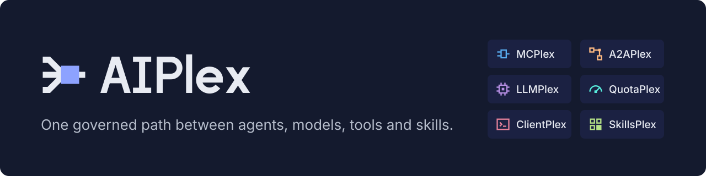

<p align="center"></p>

# AIPlex

AIPlex is a gateway that sits between the people, agents and developer tools that call AI models and MCP tools, and those models and tools, so that access, identity and usage are decided and recorded in one place.

<picture>
  <source media="(prefers-color-scheme: dark)" srcset="brand/launch/architecture-dark.svg">
  
</picture>

## Try it in 60 seconds

You need Go 1.25 or newer, `curl` and a terminal. No Docker, cloud account or API key.

```bash
git clone https://github.com/vamsiramakrishnan/aiplex.git
cd aiplex
make build
export PATH="$PWD/bin:$PATH"
aiplex dev
```

`aiplex dev` starts the API in memory on `127.0.0.1:8080` with a built-in mock provider and a built-in MCP server, creates an access point called `local`, and signs you in as a local admin. The mock provider has four models, one per wire: `mock-gpt` (OpenAI Chat Completions), `mock-responses` (OpenAI Responses), `mock-claude` (Anthropic Messages) and `mock-gemini` (Gemini generateContent). It prints this (output of a source build from `make build`, copied as printed):

```text
  AIPlex local development

  API            http://127.0.0.1:8080  (development mode, in memory, loopback only)
  You            developer@localhost  (admin; token from a local issuer, valid 12h)
  Models         mock-gpt, mock-claude, mock-responses, mock-gemini  (built-in mock provider, no API key)
                 wires: OpenAI Chat, Anthropic Messages, OpenAI Responses, Gemini generateContent
  Tools          local-tools: echo, add, reset_counter  (built-in MCP server)
  Access point   local  ->  http://127.0.0.1:8080/ap/local
  Price          placeholder rates for each mock model, so estimated cost shows in usage
  Quota          off (optional: QuotaPlex reads an operator policy file named by AIPLEX_QUOTA_FILE)
  CLI context    "local" (current)
  Console        not in this binary (a source build without Node). Release binaries include it;
                 from source: make console && make build (Node 22), then restart aiplex dev
  API log        /root/.aiplex/dev-api.log

  WARNING: development mode serves unauthenticated requests as admin; never expose, tunnel or proxy 127.0.0.1:8080.

  Ready in 0.1s. Try next, in another terminal:

    # 1. Send a chat request through the access point
    eval "$(aiplex dev env)"
    curl -s "$AIPLEX_URL/ap/local/v1/chat/completions" \
      -H "Authorization: Bearer $AIPLEX_TOKEN" -H "Content-Type: application/json" \
      -d '{"model":"mock-gpt","messages":[{"role":"user","content":"Hello"}]}'
    # (any OpenAI SDK works too: the eval line sets OPENAI_BASE_URL and OPENAI_API_KEY)

    # 2. See what it cost and who made it
    aiplex usage records

    # 3. Point an MCP client or IDE at it, and see where the Console is
    aiplex connect local
    aiplex dev status

    # 4. Optional: see what a caller with no role gets. Admission lets it reach the
    #    access point; calling a model also needs a grant from you (steps b and c)
    aiplex access-points create team --model mock-gpt=local-models --allow-users bob@localhost
    BOB=$(aiplex dev token --user bob)    # a: its stderr names bob's principal ID
    aiplex agents user-scopes set PRINCIPAL_ID --scopes llm:model:mock-gpt,llm:surface:local-models:*   # b
    curl -s "$AIPLEX_URL/ap/team/v1/chat/completions" -H "Authorization: Bearer $BOB" \
      -H "Content-Type: application/json" -d '{"model":"mock-gpt","messages":[{"role":"user","content":"Hi"}]}'   # c

  Press Ctrl+C to stop. State is in memory and is discarded on stop.
```

The Console is not in a plain `make build` binary: the summary says so, and the Console line changes once it is built in. To get it from source, run `make console && make build` (needs Node 22) and start `aiplex dev` again. Release binaries include the Console.

To run it in the background, use `aiplex dev --detach`, then `aiplex dev status` to check it and `aiplex dev stop` to stop it. Its output goes to `~/.aiplex/dev.log`. A second `aiplex dev` is refused while one is running.

In a second terminal (from the same directory), send a request through the access point:

```bash
export PATH="$PWD/bin:$PATH"
eval "$(aiplex dev env)"

curl -s "$AIPLEX_URL/ap/local/v1/chat/completions" \
  -H "Authorization: Bearer $AIPLEX_TOKEN" -H "Content-Type: application/json" \
  -d '{"model":"mock-gpt","messages":[{"role":"user","content":"Hello"}]}'
```

```json
{"choices":[{"finish_reason":"stop","index":0,"message":{"content":"Hello from the AIPlex mock model. You said: Hello","role":"assistant"}}],"created":1794287630,"id":"chatcmpl-mock-1794287630385369003","model":"mock-gpt","object":"chat.completion","usage":{"completion_tokens":9,"prompt_tokens":1,"total_tokens":10}}
```

Now ask who used what:

```bash
aiplex usage summary
```

```text
REQUESTS  ERRORS  DENIED  IN  OUT  COST
1         0       0       1   9    USD 0.000006 (estimated)

1 records scanned.
```

`aiplex usage records` lists each call with its caller, and `aiplex usage records -o wide` adds the record IDs and every counter:

```text
TIME      MODEL/TOOL  CALLER               ACCESS POINT  STATUS  IN  OUT  COST
just now  mock-gpt    developer@localhost  local         ok      1   9    USD 0.000006 (estimated)

Record IDs and every counter: -o wide. One record in full: aiplex usage get <id>.
```

Stop `aiplex dev` with Ctrl+C. State is in memory and is discarded.

### What you just saw

- A request went to an **access point**, one stable URL (`/ap/local/...`) that admits callers by kind and identity before any model or tool work happens. Your OpenAI-style client only needed a base URL and a token (`OPENAI_BASE_URL` and `OPENAI_API_KEY` are set by the `eval` line, so an OpenAI SDK works unchanged).
- The call was recorded in a **usage ledger**: who called, which model, tokens in and out, and cost. The cost says `(estimated)` because the price is a placeholder; a token count or price that is not known is shown as unknown, never as zero.
- The same access point serves MCP tools at `http://127.0.0.1:8080/ap/local/mcp`. `aiplex connect local` prints ready-to-paste configuration for curl, MCP clients and several developer clients.

To configure Claude Code, Codex or Gemini CLI for it, `aiplex connect local --client claude-code --write` shows a diff, keeps a backup and can be undone. `aiplex mcp serve` gives a coding agent read-only tools to inspect AIPlex ([harness onboarding](docs/harness-onboarding.md)).

More to try with `aiplex dev` running: `aiplex usage records`, `aiplex usage summary --by model`, `aiplex connect local`, and the [examples](examples/README.md). `make demo` scripts the whole run, including a streaming request and an MCP tool call, and exits non-zero on the first failure. `aiplex dev --otel http://127.0.0.1:4318` exports traces and metrics to an OTLP collector you run ([observability](docs/observability.md)); without it nothing is exported.

### Next: an access point and a price

Create a second access point with the guided command. `--model` exposes a model under a client-facing name, `--tool` exposes a tool connection, and with no `--allow-*` flag every verified caller of the allowed kinds may call it:

```bash
aiplex access-points create team --model mock-gpt=local-models --tool local-tools
```

```text
Created access point team (revision 1): http://127.0.0.1:8080/ap/team

Next:
  aiplex connect team                 # client configuration
  aiplex access-points get team
```

Set the price used to estimate cost for a model. The mock model already has a placeholder price; this sets one for another model name, in dollars per million tokens:

```bash
aiplex usage prices set gpt-4o-mini --input-per-mtok 0.15 --output-per-mtok 0.60
```

```text
Created price gpt-4o-mini (revision 1): input USD 0.15/Mtok, output USD 0.60/Mtok
```

Prices are only used to estimate cost; `aiplex usage prices list` shows them. A price file (`aiplex usage prices set -f price.json`) takes the full specification.

To start from public list prices instead, the binary carries a pinned snapshot of a third-party price list. Nothing is priced from it automatically; you choose what to import:

```bash
aiplex usage prices catalog search gpt-4o
aiplex usage prices catalog import openai/gpt-4o-mini --dry-run   # exact rates, source and snapshot date, nothing written
aiplex usage prices catalog import openai/gpt-4o-mini --yes
```

Catalogue prices can be stale or wrong, and discounts or commitments are not reflected; cost from them stays `estimated`. See [the usage ledger](docs/usage-ledger.md#prices) and [access points](docs/access-points.md).

### When a command fails

Errors name the problem, give a hint, and use a fixed exit code (see [the CLI reference](docs/cli.md#exit-codes)). A mistyped access point ID gets a suggestion:

```bash
aiplex access-points get locl
```

```text
Error: access point "locl" not found
  Did you mean: local
  List them with: aiplex access-points list
  aiplex dev keeps state in memory: anything created before it restarted is gone.
```

The command exits with code 4 (not found). Add `--debug` to see the raw API error.

## What it does

AIPlex separates **who is calling** from **what they are calling**, and puts one policy and one record in between.

| Callers | How AIPlex tells them apart |
| --- | --- |
| **Agents** | Registered workloads. They authenticate with a token from their own platform, bound to a registered agent ([agent identity federation](docs/agent-identity-federation.md)). A delegated call keeps both the user and the agent identity. |
| **Users** | People who sign in through a corporate identity provider such as Google Workspace, Microsoft Entra ID or Okta, or any OIDC issuer ([user identity federation](docs/user-identity-federation.md)). Groups come from verified claims or a signed directory authority. |
| **Clients** | Registered developer clients such as Claude, Codex and Antigravity ([ClientPlex](docs/clientplex.md)). AIPlex produces reviewed configuration for them and, when you ask (`aiplex connect --write`), merges it into the client's own config file with a diff, a backup and an undo ([harness onboarding](docs/harness-onboarding.md)). It does not install the client binaries. |

| Resources | What AIPlex does |
| --- | --- |
| **Models** (LLMPlex) | Forwards native model operations to OpenAI, Anthropic, Azure OpenAI, Bedrock, Gemini Developer and OpenAI-compatible endpoints, and Google Cloud endpoints, over HTTP, SSE and WebSocket where the surface supports it. Provider credentials are references, not values. See [model providers](docs/model-providers.md). |
| **Tools** (MCPlex) | Fronts MCP servers with upstream authentication and allow/deny and read-only tool policy. See [tool connection auth](docs/tool-connection-auth.md). |
| **Skills** (SkillsPlex) | Lists deployed skills and records reported invocation history. A report does not execute a skill or prove authorization. |

Around those:

- **Access points** give a group of callers one URL in front of models, tools and skills ([specification](docs/access-points.md)).
- **The usage ledger** records every managed exchange ([specification](docs/usage-ledger.md)). Cost is unknown until you set a price or import one from the bundled third-party list-price catalogue ([prices](docs/usage-ledger.md#price-catalogue)).
- **Observability**: OpenTelemetry traces and metrics for each request and managed exchange, exported over OTLP when you set an endpoint, and a Prometheus `/metrics` route. Prompts and credentials are never recorded ([guide](docs/observability.md)).
- **Harness onboarding**: `aiplex connect --write` configures Claude Code, Codex and Gemini CLI, and `aiplex mcp serve` gives a coding agent read-only tools over AIPlex ([guide](docs/harness-onboarding.md)).
- **Least-privilege deployment**: `aiplex platform preflight` checks the Google Cloud permissions, APIs and billing that the deployment needs before anything is created, and the platform's own identities hold narrower grants ([guide](docs/gcp-permissions.md)).
- **QuotaPlex** (opt-in) shares budgets and admission controls on covered execution paths ([guide](docs/quotaplex-core.md)).
- **A2APlex** invokes native cloud agents (Google, AWS, Foundry, Copilot) and records delegation history ([guide](docs/connected-plexes.md)).
- **Networking** prepares private-connectivity and egress plans ([guide](docs/anvil-deployment-provider.md)).

### Request paths

```text
Agents / IDEs / CLIs
       │
       ├── managed path ─────────► AIPlex API  /ap/{id}/...  (models, MCP tools, skills)
       │                             verifies the caller, applies admission and, when
       │                             enabled, quota; writes the usage ledger
       │
       └── gateway path ─────────► Envoy AI Gateway  /mcp/*  /a2a/*  /llm/*
                                     ext_authz (aiplex-authz) + rate limiting
```

These are two separate paths. A request on one is not metered or admitted by the other, and access points do not intercept traffic that bypasses them. See the [access-point specification](docs/access-points.md) and the [execution coverage matrix](docs/quotaplex-execution-coverage.md) for what each path covers.

Effective access for a delegated call is the intersection of three limits: what the agent may use, what the user may use, and what the user consented to for this session. The authorization path is implemented by [`policies/aiplex_authz.rego`](policies/aiplex_authz.rego) and the Rust service in [`authz/`](authz/).

## What is implemented, and what is not

### Components

| Component | Language | State |
| --- | --- | --- |
| AIPlex API (`cmd/aiplex-api`) | Go | Runs locally in memory with `aiplex dev`. Firestore-backed storage is covered by tests against the Firestore emulator; it has not been run against managed Firestore. |
| AIPlex CLI (`cmd/aiplex-cli`) | Go | Builds and passes tests. Includes `aiplex dev`. |
| Console (`console/`) | React and TypeScript | Embedded in the CLI binary when built first (`make console`). |
| `aiplex-authz` (`authz/`) | Rust | Scope authorization for the gateway `ext_authz` hook; has its own tests in CI. |
| Go SDK (`sdk/`) | Go | Client for the API. |
| Python and TypeScript SDKs (`sdk/python/`, `sdk/typescript/`) | Python, TypeScript | Unpublished clients for the API, run against the local development stack only (`make sdk-test`). |
| Deployment (`deploy/`) | Terraform, Helm, Kubernetes, Ory config | Helm charts are linted in CI. No deployment to a live cloud project is recorded in this repository. |
| Docs site (`docs-site/`) | Docusaurus | Builds with broken links as errors. |

### Modules

| Module | What it does | Boundary |
| --- | --- | --- |
| **MCPlex** | Connect tools, register OAuth clients, authorize users and invoke configured tools | Tool connections, delegated OAuth, eight upstream auth types, allow/deny and read-only tool policy, and stateless JSON/finite-SSE execution. Registration alone does not execute or meter a tool. |
| **A2APlex** | Invoke native cloud agents and inspect delegation history | Google, AWS, Foundry and Copilot connections, actor-separated sessions and reported delegation chains. Opaque agent-internal model/tool calls need their own instrumentation. |
| **LLMPlex** | Configure model routes/surfaces and forward native model operations | HTTP/SSE/Live protocols, client wire facades, OpenAI/Anthropic/Azure/Bedrock/OpenAI-compatible/Gemini Developer provider surfaces, media and [batch](docs/model-batches.md) operations, and stateful resource ownership. Available protocols and models are explicit operator configuration. |
| **ClientPlex** | Connect Antigravity, Codex and Claude clients to supported model endpoints | Client profiles, saved registrations, protocol checks and reviewed configuration fragments. ClientPlex itself writes no workstation files, installs no clients, issues no credentials and grants no model access; the CLI's opt-in `aiplex connect --write` edits the client's config file ([harness onboarding](docs/harness-onboarding.md)). A rendered plan stays `configured-unverified` until the installed client, provider access and deployment are qualified. |
| **SkillsPlex** | Discover deployed skills and inspect invocation history | Skill manifests, capabilities and attributed audit records. |
| **QuotaPlex** | Share budgets and admission controls across supported execution paths | Allocations, prices, funding, budget holds, admitted rates, permits, scheduling and settlement. Opt-in; only explicitly covered paths are protected. |
| **Networking** | Prepare private connectivity, identity and egress configuration | Native network artifacts and optional reviewed Anvil execution. Saved intent, successful apply and observed readiness are separate states. |

The shared identity layer verifies workforce, workload and native-agent credentials and keeps principal and actor memberships separate. Identity also connects native Google Agent Registry/IAM, AWS AgentCore Identity and Microsoft Entra Agent ID through scoped inventory, reviewed policy plans and durable apply receipts ([native governance](docs/native-agent-governance.md)). See [module contracts](docs/modules.md).

### QuotaPlex

QuotaPlex supports unequal token, money and request allocations, independent human and agent attribution, fixed, anchored and calendar periods, explicit budget loans, atomic admission, rate limits, concurrency and weighted scheduling. LLMPlex and MCPlex keep their native protocols; QuotaPlex owns admission and accounting. A request-count profile measures the managed exchange; it does not measure an async job's lifetime or an agent's internal work.

| Capability | Implemented | Still missing |
| --- | --- | --- |
| Membership | Verified group claims, a signed authority, and on-demand directory group lookups for user identity providers (Entra, Google Cloud Identity, Okta); independent principal/actor views | Native directory synchronization and distributed revocation event consumers |
| Allocations | Unequal budgets, exact prices, supported periods and explicit loans | Rolling budgets, split charging, currency conversion, automatic lending and population rebalance |
| Model/tool metering | Supported native text profiles, with each provider format's observation status in the [usage-format coverage matrix](docs/reference/usage-formats/coverage.md); media-unit and batch-usage bindings ([batches](docs/model-batches.md)); stateless JSON/finite-SSE tool call counts; WebSocket sessions as one request-count admission with advisory usage, or per-response and allowance-window token metering on opt-in surfaces ([details](docs/model-providers.md#websocket-sessions)) | Live/async job billing, cache and server-tool profiles, tool rows/bytes/duration, and token metering for non-Messages Bedrock InvokeModel bodies |
| Recovery | Durable evidence, restart-safe settlement and reviewed reconciliation | Native provider status/usage lookup adapters; long-running renewal and acknowledged cancellation |
| Enforcement coverage | Exact bindings on supported managed API paths; access-point QoS that fails closed without a covering control | Automatic Envoy/direct-route interception and authenticated remote admission/settlement RPC |
| Operations | Policy preview/export, attempt/balance inspection, loans and corrections in API/CLI/Console | Isolated shadow evaluation, runtime coverage qualification and alerts for aging unknown exposure |
| Throughput | Shared admitted-demand rates, concurrency and atomic weighted capacity admission; opt-in provider-limit cooldown and headroom gate per surface and replica ([details](docs/model-providers.md#capacity-policy)) | Provider capacity reservation, stream token pacing, preemption and provider minimum-throughput guarantees |

Existing Envoy routes and direct provider calls do not automatically pass through this quota path. Admitted tokens/s and requests/s are separate from actual provider generation throughput. Hard limits need verified provider bounds, prices, identity sources and routing for each enabled profile.

### Usage coverage

The [usage-format coverage matrix](docs/reference/usage-formats/coverage.md) lists, per provider, surface and transport, whether usage is `exact`, `advisory` or `unsupported`. At this commit it has 47 exact rows, 9 advisory and 5 unsupported. "Exact" means the gateway reproduces the recorded fixture; the fixtures are recorded or documented provider responses, not live calls.

## Try a real provider

`aiplex dev` can forward to OpenAI, Anthropic or Gemini instead of the mock model. Name the environment variable that holds your key; the key is not accepted as a flag and is never printed or written to disk:

```bash
export OPENAI_API_KEY=...          # your own key
aiplex dev --provider openai --api-key-env OPENAI_API_KEY
```

Use `--provider anthropic` or `--provider gemini` with the matching variable, and `--model` to choose a model. Without the variable set, `aiplex dev` stops with an error that names it. **This path has not been run against a live provider by the project**, so treat the first run as a test. Real-provider requests cost whatever your provider charges.

## Deploy

Deploying to a cluster is a multi-step operation, not a single command: Terraform for the infrastructure, Helm for the application, identity configuration for your own identity providers, and operator-supplied provider credentials. Start from [Install the platform][docs-install] and the [Helm identity configuration](docs/helm-identity-config.md). Run `aiplex platform preflight` to see which Google Cloud permissions the deployer lacks; `aiplex platform apply` refuses to start while they are missing. Upgrading an existing deployment has its own steps ([Google Cloud permissions](docs/gcp-permissions.md)). Read the [production qualification](docs/production-qualification.md) notes before enabling hard limits.

## Project status

AIPlex is **pre-1.0**. Interfaces, flags and output formats can change between releases, and the CLI's output is being reworked.

What has been validated, from the repository's own tests and CI:

- Go unit and integration tests, an end-to-end suite that runs the real `aiplex-api` and `aiplex` binaries against local mock upstreams (`make e2e`), and a scripted first run (`make demo`).
- Provider usage formats replayed from fixtures built from provider documentation.
- Firestore transactions and recovery against the official Firestore emulator.
- Console tests and build, Helm lint, Rust tests, and JSON schema checks.
- Config merge, diff, backup and undo for the three client files, the stdio MCP server, OpenTelemetry export to an in-process OTLP receiver, the Google Cloud preflight against a fake Google API, and the price catalogue import. Each uses isolated homes, fixtures or fakes.

What has not been validated, and is not recorded anywhere in this repository:

- Any run against live OpenAI, Anthropic, Google, Azure or AWS model endpoints.
- Any comparison of AIPlex's usage or cost figures against a provider invoice.
- A deployment to a live cloud project, and load, availability or backup-restore behaviour. The Google Cloud permissions table, the preflight, the custom deployer role and the narrowed runtime grants have not been run against a live project.
- Client configuration written by `aiplex connect --write` has not been loaded by an installed Claude Code, Codex or Gemini CLI, and the Claude Code plugin and Gemini CLI extension have not been loaded by their harnesses.
- OpenTelemetry export has not been run against a real collector, Jaeger, Cloud Trace or Cloud Monitoring, and the telemetry overhead has not been measured.
- The price catalogue is a third-party snapshot (LiteLLM, retrieved 2026-11-10). Its prices have not been checked against provider price pages, and discounts and commitments are not reflected.
- Cost shown by `aiplex dev` is from placeholder prices. The local development server is unauthenticated and must stay on loopback.

See [SECURITY.md](SECURITY.md) for the security model's current limits.

## Documentation and community

- [Documentation site][docs] · [Run it locally][docs-local] · [Concepts][docs-concepts]
- [Examples](examples/README.md)
- [CLI reference](docs/cli.md): how the `aiplex` command finds the API and token, output formats, exit codes, confirmations and shell completion
- [Contributing](CONTRIBUTING.md) · [Code of conduct](CODE_OF_CONDUCT.md) · [Security policy](SECURITY.md) · [Changelog](CHANGELOG.md)
- Repository layout: `cmd/` (API and CLI), `internal/` and `pkg/` (Go packages), `console/` (React), `authz/` (Rust), `sdk/` (Go SDK), `deploy/` (Terraform, Helm, Kubernetes, Ory), `docs/` (verified guides), `docs-site/` (the site), `brand/`, `examples/`, `tests/`. [CLAUDE.md](CLAUDE.md) has a short orientation for contributors and coding assistants.

## License

Apache License 2.0. See [LICENSE](LICENSE). The price catalogue snapshot under `pkg/pricecatalog/` is third-party data under the MIT licence; see [THIRD_PARTY_NOTICES.md](THIRD_PARTY_NOTICES.md).

<!-- The documentation address. This block is the only place the README spells it out. -->
[docs]: https://vamsiramakrishnan.github.io/aiplex/
[docs-local]: https://vamsiramakrishnan.github.io/aiplex/docs/getting-started/local-development
[docs-concepts]: https://vamsiramakrishnan.github.io/aiplex/docs/concepts
[docs-install]: https://vamsiramakrishnan.github.io/aiplex/docs/getting-started/install-platform
