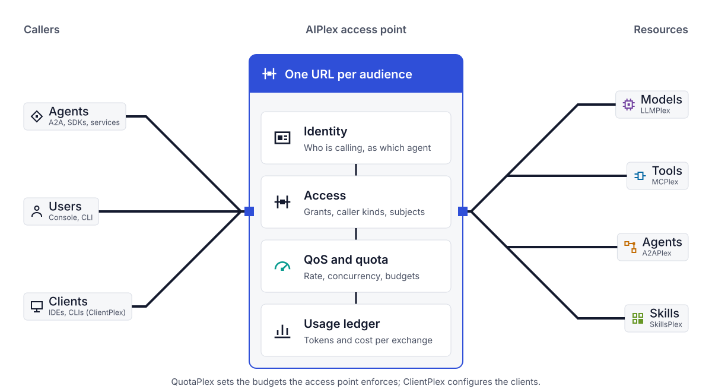

<p align="center"></p>

# AIPlex

**One access point in front of your AI models, tools and skills: every call identified, checked against policy, and written to a usage ledger.**

AIPlex is a self-hosted control plane that sits between callers (agents, people, and coding tools such as Claude Code or Codex) and the models and MCP (Model Context Protocol) tools they use. For each request it answers three questions in one place: who is calling, may they call this, and what did it cost. Provider keys stay with the operator; callers get a stable URL and their own identity.

<picture>
  <source media="(prefers-color-scheme: dark)" srcset="brand/diagrams/architecture-dark.svg">
  
</picture>

> **Pre-1.0.** It runs locally, and its model path has been exercised live against the Gemini Developer API and z.ai. It has not been deployed to a live cloud project or run against first-party OpenAI or Anthropic endpoints. [What is and is not validated](#project-status).

## Quick start

You need Go 1.25 or newer, `make` and `curl`. No Docker, cloud account or API key.

```bash
git clone https://github.com/vamsiramakrishnan/aiplex.git
cd aiplex
make build && export PATH="$PWD/bin:$PATH"
aiplex dev
```

`aiplex dev` runs the API in memory on `127.0.0.1:8080` with a mock model provider and a mock MCP server, creates an access point called `local`, and signs you in as a local admin. It prints what it started and what to try next.

In a second terminal, from the same `aiplex` directory, send a request through the access point, then ask what it cost:

```bash
export PATH="$PWD/bin:$PATH"
eval "$(aiplex dev env)"       # AIPLEX_URL and AIPLEX_TOKEN, plus the variables OpenAI and Anthropic SDKs read

curl -s "$AIPLEX_URL/ap/local/v1/chat/completions" \
  -H "Authorization: Bearer $AIPLEX_TOKEN" -H "Content-Type: application/json" \
  -d '{"model":"mock-gpt","messages":[{"role":"user","content":"Hello"}]}'

aiplex usage records
```

```text
TIME      MODEL/TOOL  CALLER               ACCESS POINT  STATUS  IN  OUT  COST
just now  mock-gpt    developer@localhost  local         ok      1   9    USD 0.000006 (estimated)
```

What happened:

- The request went to an **access point**, a stable URL (`/ap/local/...`) that admits callers by kind and identity before any model or tool work happens. An OpenAI SDK works unchanged, because the `eval` line pointed its base URL at the access point and set its key to the local developer token (not a provider key).
- The call was written to the **usage ledger**: who called, which model, tokens in and out, and cost. The cost says `(estimated)` because the mock model's price is a placeholder. A count or price that is not known is shown as unknown, never as zero.
- The same access point serves MCP tools at `/ap/local/mcp`.

Development mode also serves requests that carry no token, as admin. That is why it keeps to loopback and must never be exposed, tunnelled or proxied. State is in memory and is discarded on stop. Stop it with Ctrl+C.

### Where to go next

| You want to | Run or read |
| --- | --- |
| Point Claude Code, Codex, Gemini CLI or an MCP client at it | `aiplex connect local` prints the configuration; `--client claude-code --write` applies it with a diff, a backup and an undo ([harness onboarding](docs/harness-onboarding.md)) |
| Give a team its own access point | `aiplex access-points create team --model mock-gpt=local-models --tool local-tools`: `--model` is `name=surface` and `--tool` names a tool connection; `local-models` and `local-tools` are the ones `aiplex dev` creates ([access points](docs/access-points.md)) |
| Use a real provider instead of the mock | `aiplex dev --provider openai --api-key-env OPENAI_API_KEY` (also `anthropic`, `gemini`). The key is read from the named variable and is never a flag, printed or written to disk. Of the three, only Gemini has been run live this way ([real provider keys](docs/local-development.md#real-provider-keys)) |
| Put a price on a model | `aiplex usage prices set` or `aiplex usage prices catalog import` ([usage ledger](docs/usage-ledger.md#prices)) |
| See every caller and what it can reach | `aiplex who` |
| Open the Console | `make console && make build` (Node 22), then restart `aiplex dev` |
| Watch the whole first run scripted | `make demo`, and the [examples](examples/README.md) |
| Walk through all of this slowly | [Run it locally](docs/local-development.md) |

When a command fails it names the problem, suggests a fix (`access point "locl" not found. Did you mean: local`) and exits with a [documented code](docs/cli.md#exit-codes). `aiplex doctor` checks your setup.

## How it is named

A **plex** is a module that puts *many things of one kind behind one front*, as in multiplex: many signals, one line. LLMPlex, MCPlex, A2APlex and SkillsPlex each put many upstreams behind one endpoint, with the same identity check, policy and usage record applied to all of them. ClientPlex and QuotaPlex turn many client registrations, or many budgets and limits, into one configuration or one decision. AIPlex is those plexes plus the parts they share: identity, access points and the usage ledger.

| Plex | Many of what | One what in front | CLI |
| --- | --- | --- | --- |
| **LLMPlex** | Models, across providers and wire protocols | One model endpoint; requests are forwarded in the provider's native protocol | `aiplex llm` |
| **MCPlex** | MCP tool servers | One MCP endpoint, with upstream authentication and tool policy | `aiplex mcp`, `aiplex tools`, `aiplex tool-auth` |
| **A2APlex** | Agents that speak A2A (the Agent2Agent protocol), and native cloud agents | One way to invoke them and one delegation history | `aiplex a2a` |
| **SkillsPlex** | Deployed skills | One list and one invocation history | `aiplex skills` |
| **ClientPlex** | Developer clients (IDEs, coding CLIs) | One reviewed configuration per client | `aiplex clients`, `aiplex connect` |
| **QuotaPlex** (opt-in) | Budgets, allocations and limits | One admission decision and one settlement per request | `aiplex quota`, `aiplex budgets` |

The Plex name is the module; the plain word is what you type. [Naming and glossary](docs/naming.md) defines the rest of the vocabulary (caller, surface, wire, connection, principal and actor) and the commands that are easy to confuse.

## How it works

**Callers** are one of three kinds. The kind comes from the verified token; a request cannot choose it.

- **Agents**: registered workloads that authenticate with a token from their own platform ([agent identity federation](docs/agent-identity-federation.md)). A delegated call keeps both the user and the agent identity.
- **Users**: people who sign in through Google Workspace, Microsoft Entra ID, Okta or any OIDC issuer ([user identity federation](docs/user-identity-federation.md)).
- **Clients**: registered developer clients such as Claude Code, Codex and Antigravity ([ClientPlex](docs/clientplex.md)).

**Resources** are models, MCP tools, skills and other agents. Models are forwarded in the provider's native protocol (OpenAI, Anthropic, Azure OpenAI, Bedrock, Gemini, Google Cloud and OpenAI-compatible endpoints) over HTTP, SSE and, where the saved model configuration (a *surface*) supports it, WebSocket. Provider credentials are references, never values.

**In between**, every request on an access point goes through the same steps: verify the caller, apply admission, apply quota if QuotaPlex is enabled, run any [request hooks](docs/request-hooks.md), forward, and write the ledger record ([request lifecycle](docs/request-lifecycle.md)). Around that sit [routing, retry and fallback](docs/reliability-and-routing.md), [budgets](docs/budgets.md), [tool policy rules](docs/tool-policy-rules.md) and [OpenTelemetry export](docs/observability.md).

There are two request paths, and they do not cover each other:

```text
Agents / IDEs / CLIs
       │
       ├── managed path ──► AIPlex API  /ap/{id}/...   verifies the caller, applies admission
       │                                               and quota, writes the usage ledger
       │
       └── gateway path ──► Envoy AI Gateway  /mcp/*  /a2a/*  /llm/*
                                                       ext_authz (aiplex-authz) + rate limiting
```

`aiplex dev` and everything above use the managed path. The gateway path exists only in a cluster deployment, where Envoy routes traffic to deployed tool, agent and model workloads. A request on one path is not admitted or metered by the other, and traffic that bypasses an access point is not intercepted. The [access-point specification](docs/access-points.md) and the [execution coverage matrix](docs/quotaplex-execution-coverage.md) say what each path covers.

## Install

No release has been tagged, so nothing is published yet: **build from source** with `make build` (Go 1.25 or newer), which writes `bin/aiplex` and `bin/aiplex-api`.

The release workflow is set up to publish an install script, a Homebrew cask for macOS and container images on the first `v*` tag. None of these has run against a real release; the [getting started guide](docs-site/docs/getting-started/index.md#install) describes each.

Cluster deployment targets Google Cloud (GKE, Firestore) and is a multi-step operation, not one command: Terraform, Helm, your identity providers and your provider credentials. Start with [Install the platform][docs-install], run `aiplex platform preflight` to see which Google Cloud permissions the deployer lacks, and read [production qualification](docs/production-qualification.md) before enabling hard limits.

## Project status

AIPlex is **pre-1.0**. Interfaces, flags and output formats can change between releases.

- **Validated in CI:** Go unit and integration tests; an end-to-end suite that runs the real binaries against local mock upstreams (`make e2e`); provider usage formats replayed from fixtures; Firestore transactions against the emulator; Console, Rust, Helm lint and schema checks.
- **Run against live services:** the Gemini Developer API and z.ai, with ledger usage matching the provider's responses; Claude Code, Gemini CLI and Codex loading the configuration `aiplex connect --write` produces (Codex against the mock model only).
- **Not validated:** live OpenAI or Anthropic first-party endpoints, Azure, Bedrock or Vertex; any comparison of cost figures against a provider invoice; a deployment to a live cloud project, load or availability; macOS and Windows; the release artifacts. Catalogue prices are a third-party snapshot and are not checked against provider price pages.

[Project status](docs/project-status.md) has the full inventory: each component and module with its boundary, what QuotaPlex implements and what is still missing, and the complete validation list. [SECURITY.md](SECURITY.md) states the security model's current limits.

## Documentation

- [Documentation site][docs]: [run it locally][docs-local], [concepts][docs-concepts], guides per plex, API and CLI reference
- [Naming and glossary](docs/naming.md) · [CLI reference](docs/cli.md) · [Examples](examples/README.md)
- [Access points](docs/access-points.md) · [Usage ledger](docs/usage-ledger.md) · [Model providers](docs/model-providers.md) · [Authorization](docs/authorization.md) · [QuotaPlex](docs/quotaplex-core.md) · [Observability](docs/observability.md)
- [Contributing](CONTRIBUTING.md) · [Code of conduct](CODE_OF_CONDUCT.md) · [Security policy](SECURITY.md) · [Changelog](CHANGELOG.md). [CLAUDE.md](CLAUDE.md) is a short orientation to the repository layout for contributors and coding assistants.

## License

Apache License 2.0. See [LICENSE](LICENSE). The price catalogue snapshot under `pkg/pricecatalog/` is third-party data under the MIT licence; see [THIRD_PARTY_NOTICES.md](THIRD_PARTY_NOTICES.md).

[docs]: https://vamsiramakrishnan.github.io/aiplex/
[docs-local]: https://vamsiramakrishnan.github.io/aiplex/docs/getting-started/local-development
[docs-concepts]: https://vamsiramakrishnan.github.io/aiplex/docs/concepts
[docs-install]: https://vamsiramakrishnan.github.io/aiplex/docs/getting-started/install-platform
