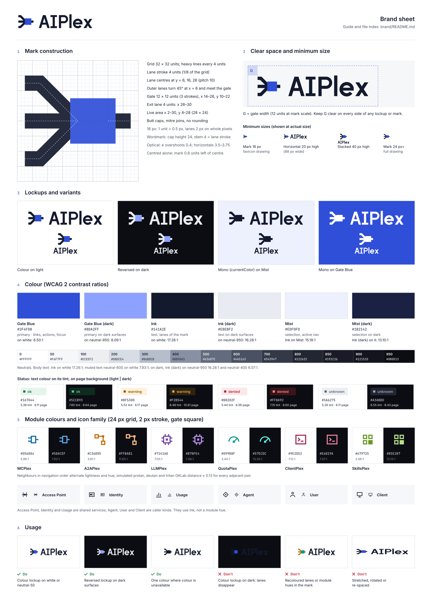

# AIPlex brand



## The mark

Three lanes converge into one square gate and leave as one lane. The lanes are callers (agents, users, clients). The gate is the single governed point: one gateway, one identity and policy layer, one usage ledger. The lane on the right is governed traffic going on to models, tools, agents and skills. The mark is a symbol, not a letter, and it has no gradients, glow or decoration.

### Construction

- Grid: 32 × 32 units. Live area x 2–30, y 4–28 (28 × 24).
- Lane stroke: 4 units (1/8 of the grid). Butt caps, mitre joins, no rounded corners.
- Lane centres at y = 6, 16, 26 (pitch 10). The outer lanes run 4 units horizontally from x = 2, then turn 45° and meet the gate.
- Gate: 12 × 12 units (three lane widths) at x 14–26, y 10–22. Exit lane: x 26–30.
- Every edge sits on a whole unit, so at 16 px (1 unit = 0.5 px) the horizontal edges land on whole pixels and the lanes are 2 px wide. `aiplex-favicon.svg` is the same drawing on a 16-unit grid with explicit 2 px strokes.
- Optical corrections: the app icon shifts the mark 8 px (0.8 units) left of centre to offset the weight of the gate. Lockups use geometric centring.

### Wordmark

"AIPlex" is drawn as outlines; it is not set in a font. Cap height 24 units, stem 4 units, the same as the mark's lane stroke at 1:1. The x-height is 17 units and the `l` rises 1.5 units above the cap height.

- One word, with capitals A, I and P. The `I` has slab bars so that "AI" cannot be read as "Al" and the `I` cannot be confused with the `l`.
- Straight terminals and 45°-family diagonals match the mark. The `e` is a circle with a horizontal bar and a radial cut, and it overshoots the x-height and baseline by 0.4 units. Horizontal strokes are 3.5–3.75 units so they look the same weight as the 4-unit verticals.
- Do not retype the wordmark in a font. Use the files.

### Lockups

- Horizontal: the mark at 1:1 next to the wordmark. The mark's outer lanes align with the cap height and the baseline. The gap is 10 units.
- Stacked: the mark at 2× is centred above the wordmark with a 12-unit gap.
- Clear space: **G** = the gate width (12 units at the scale of the mark in use). Keep G clear on every side.

### Minimum sizes

| Asset | Minimum | Notes |
|---|---|---|
| Mark | 16 px | Use `aiplex-favicon.svg` from 16 to 23 px and the full mark from 24 px. |
| Horizontal lockup | 20 px high (88 px wide) | Below this, use the mark alone. |
| Stacked lockup | 40 px high | Unreadable at 16–24 px (see the render check below). |
| Module icons | 16 px | Drawn for 24 px. They stay legible at 16 px but are not pixel-snapped at that size. |

## Colour

Colour is added on top of the drawing; the drawing does not depend on it. The mark works in one colour (`-mono` files use `currentColor`).

| Role | Light | Dark | Use |
|---|---|---|---|
| Gate Blue (primary) | `#2F4FD8` | `#8DA2FF` | Gate in the mark, primary actions, links, focus ring |
| Ink (supporting) | `#141A2E` | `#E8EBF2` | Text, lanes in the mark |
| Mist (supporting) | `#EDF0FD` | `#1B2142` | Selection, active navigation item |
| Neutrals | `#FFFFFF` `#F6F7F9` `#ECEEF2` `#D8DCE4` `#B6BDCB` `#8890A3` `#636B7E` `#4A5163` `#343947` `#222632` `#191C26` `#12151D` `#0B0D13` | | Surfaces, borders, muted text (0–950) |

Status colours. Show each one with an icon or a label as well as colour.

| Status | Light text / tint | Dark text / tint |
|---|---|---|
| ok | `#167044` / `#E5F4EC` | `#5CCB93` / `#0F2A1E` |
| warning | `#8F5300` / `#FDF1DC` | `#F2B544` / `#2E2210` |
| denied | `#B8202F` / `#FCE8EA` | `#FF8A92` / `#3A1519` |
| unknown | `#5A6275` / `#ECEEF2` | `#A3ABBD` / `#222632` |

### Contrast

`brand/scripts/palette.py` computes these WCAG 2 ratios. AA needs 4.5:1 for text and 3:1 for graphics. Every recommended pairing passes.

| Pairing | Light | Dark |
|---|---|---|
| Text (Ink) on bg / surface / raised | 17.26 / 16.10 / 17.26 | 16.28 / 15.29 / 14.24 |
| Muted text (neutral-600 / neutral-400) on bg / surface / raised | 7.93 / 7.40 / 7.93 | 6.07 / 5.71 / 5.31 |
| Gate Blue link on bg / surface / raised | 6.50 / 6.06 / 6.50 | 8.09 / 7.60 / 7.08 |
| Button label on Gate Blue (white / neutral-950) | 6.50 | 8.09 |
| Gate Blue on Mist; Ink on Mist | 5.72; 15.19 | 6.51; 13.10 |
| ok on bg / surface / tint | 6.11 / 5.70 / 5.38 | 9.64 / 9.05 / 7.60 |
| warning on bg / surface / tint | 6.17 / 5.75 / 5.52 | 10.61 / 9.97 / 8.48 |
| denied on bg / surface / tint | 6.39 / 5.96 / 5.44 | 8.60 / 8.08 / 7.15 |
| unknown on bg / surface / tint | 6.11 / 5.70 / 5.26 | 8.43 / 7.92 / 6.55 |

Light bg = `#FFFFFF`, surface = `#F6F7F9`, raised = `#FFFFFF`. Dark bg = `#0B0D13`, surface = `#12151D`, raised = `#191C26`. Borders (`#D8DCE4` / `#343947`) are decorative and are not used as the only indicator of anything.

### Module colours

There is one hue per Plex, for navigation, diagrams and icons. All share OKLCH chroma 0.15 (0.13 in dark mode). Hue changes in steps, and lightness alternates between neighbours, so adjacent items differ in lightness even when hue is not seen.

| Module (navigation order) | Light | Ratio on white | Dark | Ratio on `#0B0D13` |
|---|---|---|---|---|
| MCPlex | `#0568A4` | 5.96 | `#58ACEF` | 7.92 |
| A2APlex | `#C36D05` | 3.81 | `#FFBA81` | 11.65 |
| LLMPlex | `#7241A0` | 7.05 | `#B78FE4` | 7.46 |
| QuotaPlex | `#099B8F` | 3.44 | `#57ECDC` | 13.35 |
| ClientPlex | `#9E2D52` | 7.12 | `#E6819A` | 7.37 |
| SkillsPlex | `#679725` | 3.48 | `#B5E287` | 13.13 |

Module colours meet 3:1 for graphics. Several are below 4.5:1, so module labels use Ink or text colour, not the module hue. Module hues never mean status. Access Point, Identity, Usage and the caller kinds (agent, user, client) use Ink.

**How the colour-vision check works.** Each colour is simulated for protanopia, deuteranopia and tritanopia with the Machado, Oliveira and Fernandes (2009) matrices at full severity, applied in linear sRGB. The script then measures the OKLab distance between neighbours. The script fails below 0.10, about five times a just-noticeable difference. The smallest adjacent distance is 0.136 (QuotaPlex/ClientPlex under deuteranopia, both modes). Some pairs that are not adjacent come closer: MCPlex/LLMPlex under deuteranopia is 0.018 in light mode. Do not rely on module colour alone: always show the module icon and name.

## Typography

- Wordmark: custom outlines (above). It has no font dependency.
- Interface and documentation: **Inter**, SIL Open Font License 1.1. It has a large x-height, tabular figures (`font-variant-numeric: tabular-nums` for usage tables) and a slashed-zero option.
- Code, scopes, IDs and hex values: **JetBrains Mono**, SIL Open Font License 1.1.
- Font stacks are in `tokens.css` (`--aiplex-font-sans`, `--aiplex-font-mono`). The tokens contain no type, spacing or radius scale. The Console and docs site already have scales, and these brand assets give no basis for choosing new values.

## Icons

`icons/` holds 12 glyphs on a shared 24 × 24 grid:

- 2-unit stroke, butt caps, mitre joins, square corners, 90° and 45° angles only. Circles appear only where the subject needs one (user, gauge).
- Live area 2–22. Lines sit on whole coordinates so they are crisp at 24 px.
- Where the subject has a governed point, it is drawn as a solid square: the gate from the mark.
- Every file uses `currentColor`. Set `color` to Ink or a module colour.

| File | Meaning |
|---|---|
| `mcplex.svg` | Tools over MCP (plug) |
| `a2aplex.svg` | Agent to agent (two agents, one lane, a gate) |
| `llmplex.svg` | Models (processor package) |
| `quotaplex.svg` | Budgets and limits (gauge) |
| `clientplex.svg` | Developer clients (terminal) |
| `skillsplex.svg` | Skills (catalogue of tiles) |
| `access-point.svg` | Enforcement point per audience (posts and gate) |
| `identity.svg` | Identity (credential card) |
| `usage.svg` | Usage ledger (columns) |
| `agent.svg`, `user.svg`, `client.svg` | Caller kinds |

## Do and don't

Do:
- Use the colour files on white or neutral-50.
- Use the `-reversed` files on dark surfaces.
- Use the `-mono` files where only one colour is available.
- Keep clear space G.
- Pair module colours with the module's icon and name.

Don't:
- Put the colour files on dark backgrounds (the Ink lanes disappear).
- Recolour the lanes, or use module or status colours in the mark.
- Stretch, rotate, outline or re-space the mark or wordmark.
- Round the gate.
- Add shadows, gradients or glows.
- Retype "AIPlex" in a font, or write it as "AiPlex" or "AI Plex".

## Integration notes

| Use | File |
|---|---|
| Docs navbar logo, light theme | `logo/aiplex-lockup-horizontal.svg` |
| Docs navbar logo, dark theme | `logo/aiplex-lockup-horizontal-reversed.svg` |
| Favicon (docs and Console) | `logo/aiplex-favicon.svg`. It switches with `prefers-color-scheme`; add an `.ico`/PNG fallback if needed. |
| Console header | `logo/aiplex-lockup-horizontal-mono.svg` inlined so it takes the header's text colour, or the light/reversed pair |
| Social card (`og:image`) | `social/aiplex-social-card.svg`. Platforms need a raster image: `node brand/scripts/render.js social` writes `brand/.renders/social-card.png` (1200 × 630). |
| README banner | `social/aiplex-readme-banner.svg`. It has its own Ink panel, so it reads on light and dark pages. |
| App or PWA icon | `logo/aiplex-app-icon.svg` (512 base) |

The social card and banner use live text in Inter with fallbacks to Helvetica Neue and Arial. They were checked with Inter. The layout leaves room for the wider fallbacks.

## Scripts

All scripts use only the standard library or the Playwright copy that is already installed.

```bash
python3 brand/scripts/validate.py          # XML well-formedness and SVG hygiene for every file
python3 brand/scripts/palette.py           # contrast and colour-vision checks (exit 1 on failure)
python3 brand/scripts/palette.py --write   # regenerate tokens/tokens.css and tokens/tokens.json
node brand/scripts/render.js [filter]      # PNG renders to brand/.renders/ (git-ignored) + text overflow check
```

`render.js` renders each logo at 16, 24, 32, 64 and 256 px. It does this on light and dark backgrounds, under both `prefers-color-scheme` values, and also writes an 8× nearest-neighbour enlargement of the real 16 and 24 px rasters. It renders the icon family together at 16, 24 and 48 px. It also checks that every text element in the brand sheet, social card and banner sits inside the viewBox and does not overlap another text element.

## Files

```
brand/
  README.md                 this guide
  brand-sheet.svg           one-page overview
  logo/                     mark, wordmark, lockups (colour, -mono, -reversed), favicon, app icon
  icons/                    12 module and caller glyphs, 24 × 24, currentColor
  tokens/tokens.css         CSS custom properties, light + dark (prefers-color-scheme and data-theme)
  tokens/tokens.json        same values, plus the computed contrast and colour-vision results
  social/                   social card 1200 × 630, README banner 1280 × 320
  scripts/                  validate.py, palette.py, render.js
```
